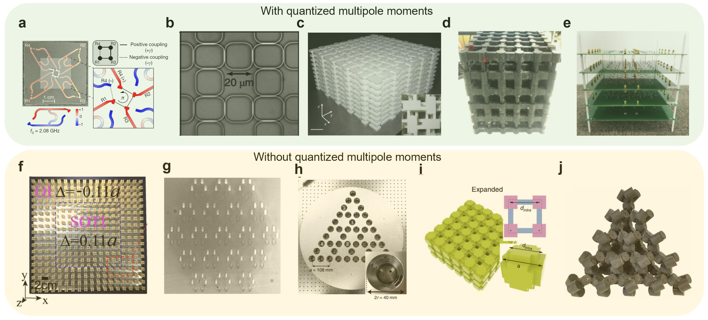

## 论文信息

**Higher-order band topology**

*Nature Reviews Physics*, 2021, **3**(7): 520–532. DOI: [10.1038/s42254-021-00323-4](https://doi.org/10.1038/s42254-021-00323-4)　|　Biye Xie, Hai-Xiao Wang, Xiujuan Zhang, Peng Zhan, Jian-Hua Jiang, Minghui Lu, Yanfeng Chen

**核心观点：** 传统拓扑绝缘体的标志是「体不变量决定无能隙边界态」，而高阶拓扑绝缘体（HOTI）恰恰相反——它的 (d−1) 维边界是**有能隙**的，受对称性保护的无能隙态出现在低两维及以下的边界上：2D 体系出现在角上，3D 体系出现在棱上。这篇综述把 2017 年之后的进展整合成三条相互补充的机制线索——边界狄拉克质量的符号反转、多极矩量子化与嵌套威尔逊环、以及填充反常导致的分数角电荷——并给出一个明确判断：**经典波体系（光子、声子、电路、机械）已经把高阶拓扑做成了可测量的事实，而电子材料中的角态至今仍缺少实验确认**。

## 关键配图与结果

### Fig. 1｜从体到面、棱、角的维度层级

图 a 用「灰色方块 = 体、蓝边 = 铰链、球 = 角」画出 2D HOTI：体内有能隙，1D 边界也有能隙，真正的无能隙态被压到 0D 的角上。图 b 把同一逻辑推到 3D：2D 面有能隙，1D 棱上出现无能隙态，角上再低一维。图 c 对比 3D 中两类铰链态：左侧手性铰链态沿棱单向绕行（实线、虚线区分前后棱，共同构成环路），对应需要时间反演破缺的表面量子反常霍尔型机制；右侧螺旋铰链态在相邻棱上方向相反，用橙、蓝两色区分反向传播的 Kramers 对。这幅图给出全文最重要的语义约定：**「高阶」指的是边界态的维度比体低两维及以上，不是微扰展开的阶数**。需要提醒的是，本文在 2D 情形也把 1D 边界称作 hinge state，与通常称 edge 的习惯不同，跨文献比较时需按上下文辨析。

### Fig. 2｜多极矩量子化与嵌套威尔逊环

面板 a 是维度层级的核心图像：体偶极矩在边上留下电荷；体四极矩在边上留下偶极、在角上留下电荷；体八极矩在面上留下四极矩、棱上留下偶极、角上留下电荷，图中标出 $q_{xy}$、$q_{zx}$、$q_{yz}$、$p_x$、$p_z$、$Q$、$O_{xyz}$。面板 b 给出 2D 四极绝缘体的紧束缚实现：每胞 4 个格点，实线、虚线分别代表正、负跃迁，每个方格积累 π 通量，于是得到两个不对易的镜面对称性——这是多极矩能够量子化的关键。面板 c 用带隙随「胞间/胞内耦合比」$\gamma/\lambda$ 的演化说明相变：体能带在 $\gamma/\lambda=0$ 处闭合后重开，带隙中央留下红色标记的边缘态。面板 d 则回答「怎么算」：先沿 $k_x$ 构造起点为 $\mathbf{k}$ 的威尔逊环 $W_{x;\mathbf{k}}$，其本征值给出万尼尔带 $\nu_x^\pm$；万尼尔带在 $\nu_x=1/2$ 处存在万尼尔能隙，再对能隙以下的万尼尔带做一次威尔逊环，得到的万尼尔带极化就是体的四极矩——这就是「嵌套威尔逊环」。面板 e–g 把构造推向 3D 八极绝缘体：8 格点/胞的立方晶格、kHz 声子带隙内成组的表面/棱/角态、以及三维嵌套威尔逊环中标出的 ×2、×4 简并结构。

### Fig. 3｜填充反常：角上的 1/4 电荷

面板 a 把「不需要量子化多极矩」的一类 HOTI 讲清楚了：$C_4$ 对称的正方晶格角上标 $1/4$、边上标 $1/2$；换成 $C_6$、$C_3$ 对称性后出现 $2/3$、$1/3$ 等不同的分数标注，取值由对称性与填充共同决定。这类分数电荷的机制是**填充反常**：有限样品里「满足电中性所需要的电子数」与「晶体对称性允许的占据数」无法同时满足，差出来的电荷只能堆到角上。面板 b 是 2D 光子 SSH 晶格的实验设计，红、绿分别对应跃迁 $t_a$、$t_b$，原胞尺寸 $l_x=l_y=a/2.8$，插图为布里渊区路径 $\Gamma$–X–M。面板 c 是拓扑相的能带结构，灰色区域标出非平庸光子带隙。面板 d 以本征值序号为横轴、频率（GHz）为纵轴，把体态、边缘态与角态分成三组点：四个角态模式（红圈）落在 $\sim6.2$–$6.4$ GHz 的带隙内，与体态、边缘态明显分离。面板 e 是把激发源放在样品边缘后测到的场分布（对数色标），在 **6.26 GHz** 处场强极大值集中在样品对角，直接把「角态」从谱线变成了图像。

### Fig. 4｜十种经典波实现

上半部分（a–e）是带量子化多极矩的实现：a 为 2D 微带线四极绝缘体（$f_0=2.08$ GHz，图例区分正、负耦合，并用四环示意 π 通量）；b 为 2D 耦合共振环光波导阵列（标尺 20 μm）；c、d 为 3D 声学共振腔网络与 3D 电路；e 为三维电路/共振网络实物。下半部分（f–j）是不依赖量子化多极矩的实现：f 为 $C_4$ 全介电光子晶体（$\Delta=\pm0.11a$，2 cm 标尺）；g 为飞秒激光直写波导阵列；h 为 $C_3$ 声学共振腔阵列（$a=108$ mm，$2r=40$ mm）；i 为「Expanded」型 3D 声子晶体（标注 $d_\mathrm{intra}$ 与 $a$）；j 为烧绿石格点的 3D 打印声学共振腔阵列。这十张照片来自不同体系、不同年份和不同课题组，展示的是实现路径的多样性，而不是同一实验内的横向对照，因此不宜据此判断哪类平台「更优」。

## 核心物理机制与总结

高阶拓扑的物理可以从三条互补的线索理解。**第一条是边界质量畴壁**，它给出最清晰的图像：把边界低能物理写成二能带大质量狄拉克模型 $H_b=v(k_x\sigma_x+k_y\sigma_y)+m\sigma_z$，$m\neq0$ 打开能隙，而 $m$ 的符号决定边界的拓扑极性；晶体对称性约束相邻两面的质量符号，符号反转处（3D 的棱、2D 的角）必然束缚一个无能隙模。这也解释了为什么 HOTI 不是边界微调的结果——低维态由体对称性强制，只要保护对称性还在，表面微扰就移不掉它。

**第二条是体多极矩的量子化**，它给出最定量的判据：四极绝缘体体偶极极化为零，但边上偶极极化 $P=1/2$、角上出现 $1/2$ 分数电荷；八极绝缘体的面内四极矩 $q_{xy}=1/2$，棱有能隙、角上有分数电荷。量子化需要反射与反演对称性、能隙下足够多的占据带以抵消低阶矩，以及正负跃迁共存带来的 π 通量与两个不对易镜面对称性。计算上，嵌套威尔逊环把「多极矩」翻译成「万尼尔带的极化」：先由威尔逊环得到万尼尔带，再对万尼尔能隙以下的带做第二次威尔逊环。**第三条是填充反常**，它最适合材料筛选：一个 2D SSH 模型在胞间耦合强于胞内耦合时给出 $\mathbf{P}=(1/2,1/2)$、填充因子 $1/4$，角上留下 $1/4$ 电荷，用占据带的对称性表示即可构造指标定量算出这个分数。要注意，这三条线索覆盖的是**不同子类**：质量畴壁图像适用于无能隙铰链态型，多极矩与填充反常适用于角态型，综述并列叙述但未给出统一分类定理。

全文最有价值的方法论洞见是**多维拓扑转变**：在 2D 声子晶体里，体带可视为 2D 大质量狄拉克体系，几何参数控制质量符号，于是 1D 边缘态出现；边缘态自身有能隙、Zak 相位量子化，又是 1D 拓扑绝缘体；相邻边缘的 1D 质量反号，再给出 0D 角态。由此可以在不关闭体能隙的前提下独立触发边缘拓扑转变与体拓扑转变，在 0D、1D、2D 态之间切换。这为「一个体系里共存波导与微腔」提供了可设计的物理基础，也是把高阶拓扑推向器件的主要理由。

局限同样清楚：电子材料中角态的实验确认仍然缺失（这也是全文最关键的空白）；非周期体系尚无实验实现；3D 自旋型 HOTI 的实验极其有限；经典波体系中角态常常不在带隙中央，甚至嵌入体连续谱形成高阶连续谱束缚态，此时仅凭谱无法与平庸绝缘体区分；「HOTI 比无能隙表面态更常见」是基于对称性计数的直觉论证，既非定理也无统计证据；对无序、相互作用与有限尺寸效应的定量讨论很少。对二维材料研究者而言，最可迁移的是「对称性指标 + 分数角电荷」的筛选路线与几何调控的拓扑转变思路——如果层间滑移或铁电极化翻转能在二维体系中独立调控边缘与体拓扑，就可能得到可切换的高阶拓扑相（此为推断，综述未涉及二维磁性/多铁体系）。

## 专业术语与英文发音

| 中文术语 | 英文术语 | IPA | 简要定义 |
|---|---|---|---|
| 高阶拓扑绝缘体 | higher-order topological insulator (HOTI) | insulator /ˈɪn·sjə·leɪ·tə(ɹ)/；topological 发音尚未核实 | (d−1) 维边界有能隙、(d−2) 维及更低维边界出现受对称性保护的无能隙态 |
| 体-边对应 | bulk-boundary correspondence (BBC) | boundary /ˈbaʊnd·ɹi/；correspondence 发音尚未核实 | 体不变量与边界无能隙态的必然对应，HOTI 把它推广到低维边界 |
| 量子化多极绝缘体 | quantized multipole insulator (QMI) | multipole / quadrupole 发音尚未核实 | 偶极矩为零、四极或八极矩量子化为 1/2 的绝缘体 |
| 嵌套威尔逊环 | nested Wilson loop | Wilson 发音尚未核实（人名） | 由威尔逊环得万尼尔带，再对万尼尔带做威尔逊环，得到多极矩 |
| 填充反常 | filling anomaly | US /əˈnɑ·mə·li/，UK /əˈnɒ·mə·lɪ/ | 电中性与晶体对称性不能同时满足，边界出现分数电荷 |
| 铰链态（手性/螺旋） | hinge state (chiral / helical) | hinge /ˈhɪndʒ/；chiral /ˈkaɪɹəl/；helical /ˈhiːlɪkəl/ | 3D HOTI 中沿棱传播的 1D 无能隙态；手性单向，螺旋为 Kramers 对 |
| 大质量狄拉克哈密顿量 | massive Dirac Hamiltonian | Dirac 发音尚未核实 | $H=v(k_x\sigma_x+k_y\sigma_y)+m\sigma_z$，质量符号决定边界极性 |
| Zak 相位 | Zak phase | Zak 发音尚未核实 | 1D 布洛赫态沿布里渊区的 Berry 相位，量子化为 0 或 π |

> 音标状态：标注 `开放词典核实` 的条目来自 Wiktionary（经 dictionaryapi.dev，CC BY-SA 3.0，非权威）；其余标「发音尚未核实」，只按拼写划分音节，不作重音断言。DOI 与书目元数据不能作为发音依据。

## 参考文献

1. Xie B, Wang H-X, Zhang X, Zhan P, Jiang J-H, Lu M, Chen Y. Higher-order band topology. *Nat. Rev. Phys.*, 2021, 3: 520–532. DOI: [10.1038/s42254-021-00323-4](https://doi.org/10.1038/s42254-021-00323-4)
2. Benalcazar W A, Bernevig B A, Hughes T L. Quantized electric multipole insulators. *Science*, 2017, 357: 61–66. DOI: [10.1126/science.aah6442](https://doi.org/10.1126/science.aah6442)
3. Benalcazar W A, Bernevig B A, Hughes T L. Electric multipole moments, topological multipole moment pumping, and chiral hinge states in crystalline insulators. *Phys. Rev. B*, 2017, 96: 245115. DOI: [10.1103/PhysRevB.96.245115](https://doi.org/10.1103/PhysRevB.96.245115)
4. Langbehn J, Peng Y, Trifunovic L, von Oppen F, Brouwer P W. Reflection-symmetric second-order topological insulators and superconductors. *Phys. Rev. Lett.*, 2017, 119: 246401. DOI: [10.1103/PhysRevLett.119.246401](https://doi.org/10.1103/PhysRevLett.119.246401)
5. Benalcazar W A, Li T, Hughes T L. Quantization of fractional corner charge in Cₙ-symmetric higher-order topological crystalline insulators. *Phys. Rev. B*, 2019, 99: 245151. DOI: [10.1103/PhysRevB.99.245151](https://doi.org/10.1103/PhysRevB.99.245151)
6. Schindler F, et al. Higher-order topology in bismuth. *Nat. Phys.*, 2018, 14: 918–924. DOI: [10.1038/s41567-018-0224-7](https://doi.org/10.1038/s41567-018-0224-7)

> 图片来源：本文所有配图均取自所评论文 PDF（arXiv:2010.05802v2）的 Fig. 1–4，按原图号、原始分辨率提取，未重绘、未改动面板结构。预印本与期刊版图件可能略有差异；公开转载前请按 Nature Reviews Physics 的版权与许可要求核定。
