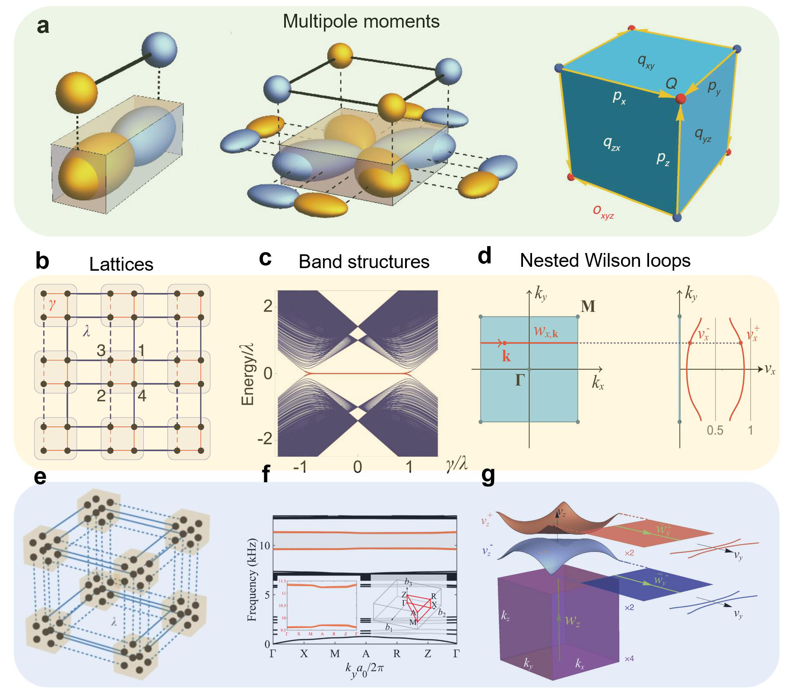

## 论文信息与核心观点

**Higher-order band topology**

*Nature Reviews Physics*, 2021, **3**(7): 520–532. DOI: [10.1038/s42254-021-00323-4](https://doi.org/10.1038/s42254-021-00323-4)
Biye Xie, Hai-Xiao Wang, Xiujuan Zhang, Peng Zhan, Jian-Hua Jiang, Minghui Lu, Yanfeng Chen

**核心观点：** 传统拓扑绝缘体的标志是「体不变量决定无能隙边界态」，而高阶拓扑绝缘体（HOTI）恰好相反：它的 (d−1) 维边界是**有能隙**的，受对称性保护的低维边界态出现在再低一维及以下的边界上——2D 体系在角上表现为带隙内角态，3D 体系则可以是棱上的无能隙铰链态，也可以是面与棱都有能隙、角上出现带隙内角态的三阶相。这篇 2021 年的综述把此前进展整合成三条互补的机制线索：边界狄拉克质量的符号反转、多极矩量子化与嵌套威尔逊环、填充反常导致的分数角电荷。它的核心判断带有明确的时间限定——**截至该综述发表时（2021 年 6 月），经典波体系（光子、声子、电路、机械）已有大量高阶拓扑的实验实现，而电子材料中的角态仍缺少实验确认**；此后是否改变需要另查近期文献。

## 关键配图与结果

### Fig. 1｜维度层级：体 → 面 → 棱 → 角

图 a 用「灰色方块 = 体、蓝边 = 铰链、球 = 角」画出 2D HOTI：体内有能隙，1D 边界也有能隙，被压到 0D 角上的是**带隙内**的角态（in-gap state）。带隙内角态不一定是零能态，它与「无能隙的传播态」也是两类不同的东西。图 b 把同一逻辑推到 3D：2D 面有能隙，1D 棱上可出现无能隙铰链态；图中同时画出更低维的角态，那对应面与棱都有能隙的三阶情形——原文把「面有能隙 + 棱无能隙」与「面与棱都有能隙 + 带隙内角态」作为两类 3D HOTI 并列。图 c 对比铰链态的两种类型：左侧手性铰链态沿棱单向绕行（实线、虚线区分前后棱，共同构成环路），对应需要破坏时间反演的机制；右侧螺旋铰链态在相邻棱上方向相反，用橙、蓝两色区分反向传播的 Kramers 对。这幅图给出全文的语义约定：**「高阶」指边界态维度比体低两维及以上，不是微扰展开的阶数**。文中在 2D 情形也把 1D 边界称作 hinge state，与通常称 edge 的习惯不同，跨文献比较时需按上下文辨析。

### Fig. 2｜多极矩量子化与嵌套威尔逊环

面板 a 是维度层级的核心图像：体偶极矩在边上留下电荷；体四极矩在边上留下偶极、在角上留下电荷；体八极矩在面上留下四极矩、棱上留下偶极、角上留下电荷，图中标出 $q_{xy}$、$q_{zx}$、$q_{yz}$、$p_x$、$p_z$、$Q$、$O_{xyz}$。面板 b 给出 2D 四极绝缘体的紧束缚实现：每胞 4 个格点，实线、虚线分别代表正、负跃迁，使每个方格积累 π 通量，从而得到两个不对易的镜面对称性——这是多极矩能够量子化的关键。面板 c 是引自 Ref. 42 的数值结果，给出带隙与边缘态随「胞间/胞内耦合比」$\gamma/\lambda$ 的演化：随耦合比变化，体能带经历闭合—重开，重开的带隙中出现位于 $E\approx0$ 附近的红色边缘态；原文正文与图注都没有给出闭合点的具体比值，因此这里不写临界数值。面板 d 是示意性的嵌套威尔逊环流程（图注明确为 schematic，不是数值数据）：左图在 $k_x$–$k_y$ 面上画出起点为 $\mathbf{k}$ 的威尔逊环，右图由该环的本征值给出万尼尔带 $\nu_x^\pm$，两条带彼此分离、中间形成万尼尔能隙，这个能隙正是后续嵌套与量子化的前提。面板 e–g 把构造推向 3D 八极绝缘体：8 格点/胞的立方晶格、kHz 声子带隙内成组的表面/棱/角态，以及三维嵌套威尔逊环中标出的 ×2、×4 简并结构。

### Fig. 3｜填充反常：角上的 1/4 电荷

面板 a 展示了不依赖量子化多极矩的另一类 HOTI：$C_4$ 对称的正方晶格角上标 $1/4$、边上标 $1/2$；换成 $C_6$、$C_3$ 对称性后出现 $2/3$、$1/3$ 等不同的分数标注，取值由对称性与填充共同决定。这类分数电荷的机制是**填充反常**：有限样品里「满足电中性所需要的电子数」与「晶体对称性允许的占据数」无法同时满足，差出来的电荷只能堆到角上。面板 b 是 2D 光子 SSH 晶格的实验设计，红、绿分别对应跃迁 $t_a$、$t_b$，原胞尺寸 $l_x=l_y=a/2.8$，插图为布里渊区路径 $\Gamma$–X–M。面板 c 是拓扑相的能带结构，灰色区域标出非平庸光子带隙。面板 d 以本征值序号为横轴、频率（GHz）为纵轴，把体态、边缘态与角态分成三组点：四个角态模式（红圈）落在 $\sim6.2$–$6.4$ GHz 的带隙内，与体态、边缘态明显分离。面板 e 是把激发源放在样品边缘后测到的场分布（对数色标），在 **6.26 GHz** 处场强极大值集中在样品对角，让「角态」从谱线变成了图像。

### Fig. 4｜十种经典波实现

上半部分（a–e）是带量子化多极矩的实现：a 为 2D 微带线四极绝缘体（$f_0=2.08$ GHz，图例区分正、负耦合，并用四环示意 π 通量）；b 为 2D 耦合共振环光波导阵列（标尺 20 μm）；c、d 为 3D 声学共振腔网络与 3D 电路；e 为三维电路/共振网络实物。下半部分（f–j）是不依赖量子化多极矩的实现：f 为 $C_4$ 全介电光子晶体（$\Delta=\pm0.11a$，2 cm 标尺）；g 为飞秒激光直写波导阵列；h 为 $C_3$ 声学共振腔阵列（$a=108$ mm，$2r=40$ mm）；i 为「Expanded」型 3D 声子晶体（标注 $d_\mathrm{intra}$ 与 $a$）；j 为烧绿石格点的 3D 打印声学共振腔阵列。这十张照片来自不同体系、不同年份和不同课题组，说明的是实现路径的多样性，而不是同一实验内的横向对照。

## 核心物理机制与总结

**边界质量畴壁。** 把边界低能物理写成二能带大质量狄拉克模型 $H_b=v(k_x\sigma_x+k_y\sigma_y)+m\sigma_z$，$m\neq0$ 打开能隙，$m$ 的符号决定边界的拓扑极性。晶体对称性约束相邻两面的质量符号：符号反转处（3D 的棱、2D 的角）会束缚一个局域模，但这个局域模**不一定**表现为无能隙的传播模——它是否无能隙要看有效模型与边界条件。这条图像的适用前提是边界态可以用大质量狄拉克理论描述、并且晶体对称性确实强制相邻边界质量反号（TCI 衍生型），不能推广到所有高阶拓扑相。作者据此论证 HOTI 不是边界微调的结果：低维态由体对称性强制，只要相应的保护对称性还在，表面微扰就移不掉它。

**体多极矩的量子化。** 四极绝缘体体偶极极化为零，但边上偶极极化 $P=1/2$、角上出现 $1/2$ 分数电荷；八极绝缘体的面内四极矩 $q_{xy}=1/2$，棱有能隙、角上有分数电荷。量子化需要反射与反演对称性、能隙下足够多的占据带以抵消低阶矩，以及正负跃迁共存带来的 π 通量与两个不对易镜面对称性。计算上，嵌套威尔逊环把「多极矩」翻译成「万尼尔带的极化」；它要求万尼尔能隙存在，是多极矩型 HOTI 的判据之一（另一种是多体多极算符），而不是所有 HOTI 的唯一判据。

**填充反常。** 这是最适合材料筛选的一支：一个 2D SSH 模型在胞间耦合强于胞内耦合时给出 $\mathbf{P}=(1/2,1/2)$、填充因子 $1/4$，角上留下 $1/4$ 电荷；用占据带的对称性表示可以构造填充反常拓扑指标，定量算出这个分数。它与多极矩型是两种不同的高阶拓扑：前者由带隙万尼尔带的四极/八极指标刻画、体偶极极化为零、需要不对易反射对称；后者不需要万尼尔能隙、体极化可以非零。二者判据不同，不能混用。

**多维拓扑转变。** 在 2D 声子晶体里，体带可视为 2D 大质量狄拉克体系，几何参数控制质量符号，于是 1D 边缘态出现；边缘态自身有能隙、Zak 相位量子化，又是 1D 拓扑绝缘体；相邻边缘的 1D 质量反号，再给出 0D 角态。由此可以在不关闭体能隙的前提下独立触发边缘拓扑转变与体拓扑转变，在 0D、1D、2D 态之间切换。这为「一个体系里共存波导与微腔」提供了可设计的物理基础，也是把高阶拓扑推向器件的主要理由。

**局限与启示。** 局限（均为该文 2021 年发表时的判断）：电子材料中角态的实验确认仍然缺失；非周期体系尚无实验实现；3D 自旋型 HOTI 的实验极其有限；经典波体系中角态常常不在带隙中央，甚至嵌入体连续谱形成高阶连续谱束缚态，此时仅凭谱无法与平庸绝缘体区分；「HOTI 比无能隙表面态更常见」是基于对称性计数的直觉论证，既非定理也无统计证据。对二维材料研究者而言，最可迁移的是「对称性指标 + 分数角电荷」的筛选路线与几何调控的拓扑转变思路——如果层间滑移或铁电极化翻转能在二维体系中独立调控边缘与体拓扑，就可能得到可切换的高阶拓扑相（此为推断，综述未涉及二维磁性/多铁体系）。

## 专业英语术语学习

以下按主题分组，覆盖理解本文所需的全部专业术语。英文拆解给出组成单词的中文含义与经核实的单词读音；人名只标人名为人名，不做构词分析。

### 拓扑与对称性

| 专业术语 | 英文拆解与 IPA | 本文中的物理含义 |
|---|---|---|
| higher-order topological insulator (HOTI) | higher 更高的 /—/；order 阶 /—/；topological 拓扑的 /—/；insulator 绝缘体 /ˈɪn.sjə.leɪ.tə(ɹ)/ | (d−1) 维边界有能隙、受保护边界态出现在低两维及更低维边界的绝缘体 |
| bulk–boundary correspondence (BBC) | bulk 体 /bʌlk/；boundary 边界 /ˈbaʊndɹi/；correspondence 对应关系 /ˌkɒɹɪˈspɒndəns/ | 体拓扑性质与边界态之间的对应；高阶情形下对应关系降到更低维边界 |
| higher-order bulk–boundary correspondence | 同上，加 higher-order 高阶 | 体不变量决定 (d−2) 维及更低维的边界态 |
| topological crystalline insulator (TCI) | topological 拓扑的 /—/；crystalline 晶态的 /—/；insulator 绝缘体 /ˈɪn.sjə.leɪ.tə(ɹ)/ | 由晶体对称性保护的拓扑绝缘体，是 HOTI 的主要来源之一 |
| crystalline symmetry | crystalline 晶态的 /—/；symmetry 对称性 /—/ | 晶体点群/空间群对称性，约束质量符号与量子化条件 |
| time-reversal symmetry (T) | time 时间 /—/；reversal 反演 /—/；symmetry 对称性 /—/ | 手性铰链态需要破坏的对称性 |
| inversion symmetry | inversion 反演 /—/；symmetry 对称性 /—/ | 多极矩量子化所需的对称性之一 |
| reflection / mirror symmetry | reflection 反射 /—/；mirror 镜面 /—/；symmetry 对称性 /—/ | 镜面反射；不对易的两个镜面对称是四极矩量子化的关键 |
| noncommutative mirror symmetries | non- 非；commutative 对易的 /—/；mirror 镜面 /—/；symmetries 对称性（复数） | 两个不对易镜面反射使子空间简并，从而允许多极矩量子化 |
| topological invariant | topological 拓扑的 /—/；invariant 不变量 /—/ | 刻画拓扑相的整数或分数指标（多极矩、Chern 数、Zak 相位等） |
| symmetry indicator | symmetry 对称性 /—/；indicator 指标 /—/ | 由占据带的对称性表示构造的判据，可定量给出分数角电荷 |
| topological phase transition | topological /—/；phase 相 /—/；transition 转变 /—/ | 参数变化使带隙闭合再重开所对应的相变 |

### 能带与计算方法

| 专业术语 | 英文拆解与 IPA | 本文中的物理含义 |
|---|---|---|
| tight-binding model (TBM) | tight 紧的 /—/；binding 结合 /—/；model 模型 /—/ | 用格点间跃迁描述能带的模型，本文实现 π 通量方格 |
| Su–Schrieffer–Heeger (SSH) model | Su、Schrieffer、Heeger 三人名；model 模型 | 一维双聚化链，拓扑相以 Zak 相位 π 为标志，有端点态与 ±e/2 |
| generalized SSH model | generalized 推广的 /—/；SSH 人名缩写；model 模型 | 把 SSH 推广到 2D/3D，得到填充反常型 HOTI |
| Wilson loop | Wilson 人名；loop 闭合回路 /luːp/ | 沿布里渊区闭合路径的并行输运相位，本征值给出万尼尔带 |
| nested Wilson loop | nested 嵌套的 /—/；Wilson 人名；loop /luːp/ | 对万尼尔带再做一次威尔逊环，得到多极矩 |
| Wannier function | Wannier 人名；function 函数 /—/ | 由占据带做傅里叶变换得到的局域轨道 |
| Wannier band | Wannier 人名；band 带 /—/ | 威尔逊环本征值随另一动量形成的能带 |
| Wannier gap | Wannier 人名；gap 能隙 /—/ | 分隔万尼尔带的能隙，多极矩量子化的前提 |
| Zak phase | Zak 人名；phase 相位 /—/ | 1D 布洛赫态沿布里渊区的 Berry 相位，量子化为 0 或 π |
| Berry phase | Berry 人名；phase 相位 /—/ | 几何相位，Zak 相位是它在 1D 的特例 |
| quantized multipole insulator (QMI) | quantized 量子化的 /ˈkwɒntʌɪzd/；multipole 多极（multi- 多 + pole 极）；insulator 绝缘体 | 偶极矩为零、四极或八极矩量子化为 1/2 的绝缘体 |
| quadrupole moment | quad- 四 + pole 极；moment 矩 /—/ | 体四极矩，$q_{xy}=1/2$ 对应分数角电荷 |
| octupole moment | oct- 八 + pole 极；moment 矩 /—/ | 体八极矩，3D 高阶拓扑的指标 |
| bulk dipole polarization | bulk 体 /bʌlk/；dipole 偶极（di- 二 + pole 极）；polarization 极化 /—/ | 体偶极极化，多极矩型 HOTI 中为零 |
| filling anomaly | filling 填充 /—/；anomaly 反常 US /əˈnɑ.mə.li/ | 电中性与晶体对称性不能同时满足，角上留下分数电荷 |
| fractional corner charge | fractional 分数的 /ˈfɹæk.ʃən.əl/；corner 角 /—/；charge 电荷 /—/ | 局域在角上的 e 的分数电荷（1/4、1/2 等） |
| many-body multipole operator | many 多 + body 体；multipole 多极；operator 算符 /—/ | 计算多极矩的另一条途径，与嵌套威尔逊环并列 |
| π-flux | flux 通量 /—/ | 每个方格积累 π 相位，产生不对易镜面对称性 |
| massive Dirac Hamiltonian | massive 有质量的 /—/；Dirac 人名；Hamiltonian 哈密顿量 /—/ | $H=v(k_x\sigma_x+k_y\sigma_y)+m\sigma_z$，质量项打开能隙 |
| Dirac mass | Dirac 人名；mass 质量 /—/ | 质量项 $m$，其符号决定边界的拓扑极性 |
| mass domain wall | mass 质量；domain 畴 /—/；wall 壁 /—/ | 相邻边界质量反号处形成的界面，束缚局域模 |
| Jackiw–Rebbi | Jackiw、Rebbi 两人名（机制名） | 一维质量畴壁束缚零模的机制 |

### 边界态与相关概念

| 专业术语 | 英文拆解与 IPA | 本文中的物理含义 |
|---|---|---|
| corner state | corner 角 /—/；state 态 /—/ | 局域在角上的 0D 态，位于带隙内 |
| hinge state | hinge 铰链 /ˈhɪndʒ/；state 态 /—/ | 局域在棱上的 1D 边界态 |
| chiral hinge state | chiral 手性的 /ˈkaɪɹəl/；hinge /ˈhɪndʒ/；state 态 | 沿棱单向传播的铰链态，需破坏时间反演 |
| helical hinge state | helical 螺旋的 /ˈhiːlɪkəl/；hinge /ˈhɪndʒ/；state 态 | 反向传播的 Kramers 对构成的铰链态 |
| Kramers pair | Kramers 人名；pair 对 /—/ | 时间反演联系的两个简并态 |
| in-gap state | in-gap 带隙内的；state 态 | 位于带隙内的局域态，不一定是零能态 |
| bound state in the continuum (BIC) | bound 束缚 /—/；state 态；continuum 连续谱 /—/ | 嵌在体连续谱中的束缚态；高阶 BIC 使角态难以从谱上辨认 |
| fractional corner anomaly | fractional 分数的 /ˈfɹæk.ʃən.əl/；corner 角；anomaly 反常 /əˈnɑ.mə.li/ | 用模式密度测量分数角电荷的实验判据 |
| Majorana zero mode | Majorana 人名；zero 零 /—/；mode 模 /—/ | 拓扑超导中的零能模，可用于编织与量子计算 |
| quantum anomalous Hall effect | quantum 量子 /—/；anomalous 反常的 /—/；Hall 人名；effect 效应 /—/ | 表面量子反常霍尔态对应手性铰链态 |
| axion insulator | axion 轴子 /—/；insulator 绝缘体 /ˈɪn.sjə.leɪ.tə(ɹ)/ | 磁电耦合型拓扑相，可产生手性铰链态 |

### 材料与实验技术

| 专业术语 | 英文拆解与 IPA | 本文中的物理含义 |
|---|---|---|
| photonic crystal | photonic 光子的 /—/；crystal 晶体 /—/ | 周期介电结构，经典波实现高阶拓扑的主要平台 |
| photonic band gap (PBG) | photonic 光子的；band 带；gap 能隙 | 光子带隙，文中标注非平庸带隙 |
| phononic / sonic crystal | phononic 声子的 /—/；sonic 声的 /—/；crystal 晶体 | 声子晶体与声学晶体 |
| acoustic metamaterial | acoustic 声学的 /—/；meta- 超越 /—/；material 材料 /—/ | 人工声学超材料 |
| coupled ring resonator | coupled 耦合的 /—/；ring 环 /—/；resonator 共振腔 /—/ | 耦合共振环构成的光波导阵列 |
| waveguide array | waveguide 波导（wave 波 + guide 导）/—/；array 阵列 /—/ | 光波导阵列平台 |
| laser-written waveguide | laser 激光 /—/；written 直写 /—/；waveguide 波导 | 飞秒激光直写波导 |
| microstrip / transmission line | micro- 微 + strip 条带；transmission 传输 /—/；line 线 /—/ | 微带线与传输线平台 |
| topolectrical circuit | topo- 拓扑 + electrical 电的；circuit 电路 /—/ | 电路（拓扑电路）实现平台 |
| synthetic dimension | synthetic 合成的 /—/；dimension 维度 /—/ | 用内部自由度模拟的空间维度 |
| quasicrystal | quasi- 准 /—/；crystal 晶体 | 准晶体系 |
| amorphous | a- 无 + morphē 形状 → 非晶的 /—/ | 非晶体系 |
| non-Hermitian | non- 非；Hermitian 厄米的（Hermite 人名）/—/ | 非厄米体系 |
| Floquet | Floquet 人名（周期驱动理论） | 周期驱动（Floquet）体系 |
| breathing kagome lattice | breathing 呼吸式的 /—/；kagome 籠目（日语，竹编孔纹）/—/；lattice 晶格 /—/ | 呼吸 kagome 晶格，可实现高阶拓扑 |
| pyrochlore lattice | pyrochlore 烧绿石（矿物名）/—/；lattice 晶格 | 烧绿石晶格，3D 高阶拓扑的实现平台之一 |

> 说明：标注了音标的单词取自开放词典（Wiktionary，经 dictionaryapi.dev，CC BY-SA 3.0，非权威）；其余单词未核实，统一记为「—」，暂不标注发音，也不按拼写编造音标。人名（Wilson、Wannier、Dirac、Zak、Kramers、Majorana、Su–Schrieffer–Heeger、Jackiw–Rebbi、Floquet、Hermite、Hall、Berry）只说明属于人名。

## 参考文献

1. Xie B, Wang H-X, Zhang X, Zhan P, Jiang J-H, Lu M, Chen Y. Higher-order band topology. *Nat. Rev. Phys.*, 2021, 3: 520–532. DOI: [10.1038/s42254-021-00323-4](https://doi.org/10.1038/s42254-021-00323-4)
2. Benalcazar W A, Bernevig B A, Hughes T L. Quantized electric multipole insulators. *Science*, 2017, 357: 61–66. DOI: [10.1126/science.aah6442](https://doi.org/10.1126/science.aah6442)
3. Benalcazar W A, Bernevig B A, Hughes T L. Electric multipole moments, topological multipole moment pumping, and chiral hinge states in crystalline insulators. *Phys. Rev. B*, 2017, 96: 245115. DOI: [10.1103/PhysRevB.96.245115](https://doi.org/10.1103/PhysRevB.96.245115)
4. Langbehn J, Peng Y, Trifunovic L, von Oppen F, Brouwer P W. Reflection-symmetric second-order topological insulators and superconductors. *Phys. Rev. Lett.*, 2017, 119: 246401. DOI: [10.1103/PhysRevLett.119.246401](https://doi.org/10.1103/PhysRevLett.119.246401)
5. Benalcazar W A, Li T, Hughes T L. Quantization of fractional corner charge in Cₙ-symmetric higher-order topological crystalline insulators. *Phys. Rev. B*, 2019, 99: 245151. DOI: [10.1103/PhysRevB.99.245151](https://doi.org/10.1103/PhysRevB.99.245151)
6. Schindler F, et al. Higher-order topology in bismuth. *Nat. Phys.*, 2018, 14: 918–924. DOI: [10.1038/s41567-018-0224-7](https://doi.org/10.1038/s41567-018-0224-7)

> 图片来源：本文配图均取自所评论文 PDF（arXiv:2010.05802v2）的 Fig. 1–4，按原图号与原始分辨率提取，未重绘、未改动面板结构。
