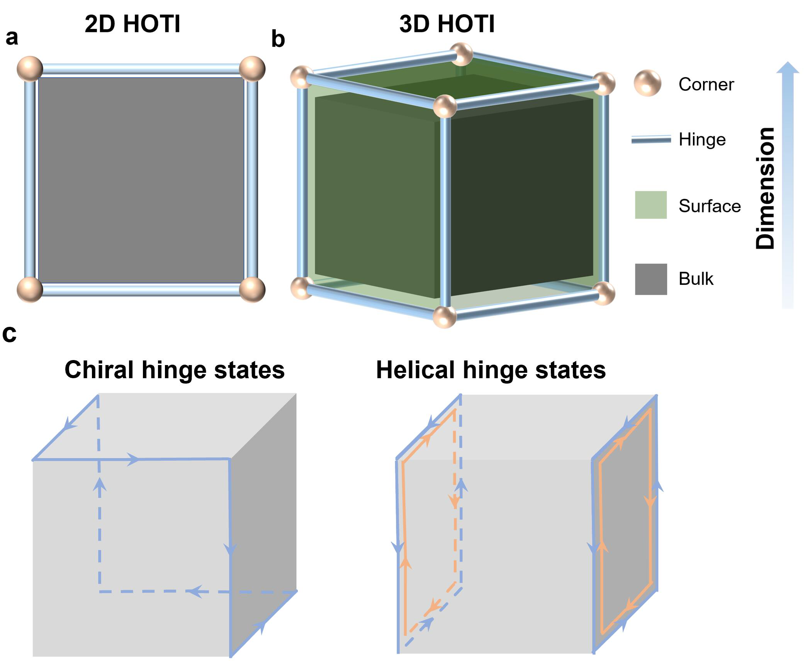
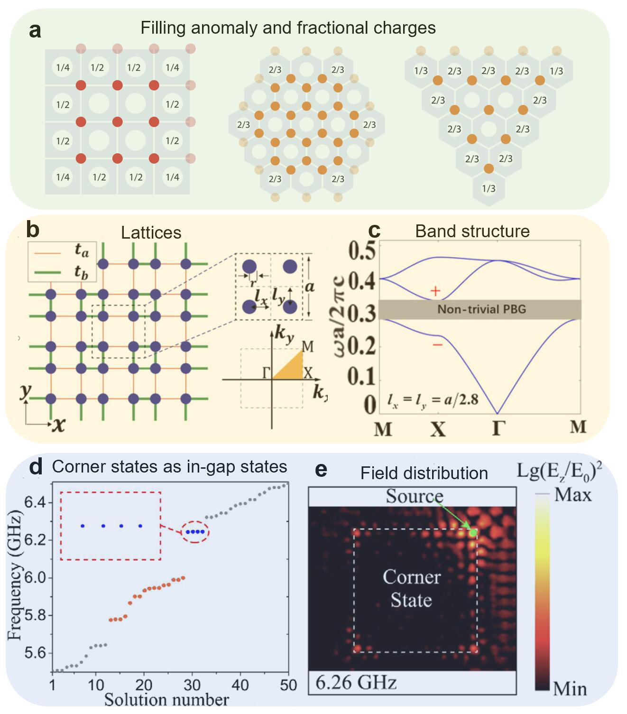

## 论文信息与核心观点

**Higher-order band topology**

*Nature Reviews Physics*, 2021, **3**(7): 520–532. DOI: [10.1038/s42254-021-00323-4](https://doi.org/10.1038/s42254-021-00323-4)
Biye Xie, Hai-Xiao Wang, Xiujuan Zhang, Peng Zhan, Jian-Hua Jiang, Minghui Lu, Yanfeng Chen

传统拓扑绝缘体的判据是体-边界对应：体不变量的非平庸性要求边界上出现无能隙态。高阶拓扑绝缘体（higher-order topological insulator，HOTI）走的是另一条路——它的 (d−1) 维边界保持有能隙，受保护的低维态出现在再低一维及以下的边界上：二维体系局域在角上，三维体系可以局域在棱上，也可以在面与棱都有能隙时局域在角上。2021 年的这篇综述把相关进展整理成三条互补的机制线索——边界 Dirac 质量的符号反转、多极矩的量子化与嵌套 Wilson 环、填充反常导致的分数角电荷——并把电子体系与光子、声子、电路、机械平台放在一起评述。它的核心判断带有明确的时间限定：截至该文发表时（2021 年 6 月），经典波平台已有大量高阶拓扑的实验实现，而电子材料中角态的实验确认仍然缺失。这一判断之后是否改变，需要另查近年文献，本文不代为更新。

## 关键配图与结果

### Fig. 1｜从体到面、棱、角的维度层级

维度层级的起点是「体是绝缘的、边界也是绝缘的」。二维情形中，体能带有能隙，一维边界同样被打开能隙，能够局域下来的只有带隙内的角态；这类角态不一定是零能态，与无能隙的传播态也不是同一类对象。三维情形多出一种可能：表面有能隙，棱上却可以存在无能隙的铰链态；若面与棱都被打开能隙，则更低一维的角态重新出现。图中把这两类三维情形并列画出，同时用箭头区分了铰链态的两种类型——沿棱单向绕行的手性态需要破坏时间反演，相邻棱上反向传播的螺旋态则由时间反演与空间对称性共同保护，构成 Kramers 对。由此也能看清「高阶」一词的含义：它指边界态的维度比体低两维及以上，而不是微扰展开的阶数。原文在二维情形也把一维边界称作 hinge state，与通常称 edge 的习惯不同，跨文献比较时需按上下文判断。

### Fig. 2｜多极矩的量子化与嵌套 Wilson 环

多极矩把「边界态有多低维」翻译成了可计算的量：体偶极矩在边上留下电荷，体四极矩在边上留下偶极、在角上留下电荷，体八极矩则在面上留下四极矩、棱上留下偶极、角上留下电荷。图的第一个面板用三级图像画出这一层级，第三个面板是引自 Ref. 42 的数值结果，横轴为胞间与胞内耦合之比 γ/λ：随耦合比变化，体能带先后经历闭合与重开，重开后的带隙中出现位于 E ≈ 0 附近的红色边缘态。原文正文与图注都没有给出闭合点的具体比值，这里也就不写临界数值。第二个面板给出二维四极绝缘体的紧束缚实现，每胞四个格点、正负跃迁共存，使每个方格积累 π 通量，由此得到两个不对易的镜面对称性——这是四极矩能够量子化的前提。第四个面板是嵌套 Wilson 环的示意流程（图注标明为 schematic，不是数据）：先由 Wilson 环的本征值得到 Wannier 带 νx±，两条 Wannier 带之间留出 Wannier 带隙，再对带隙以下的 Wannier 带求一次 Wilson 环，得到的 Wannier 带极化就是体的四极矩。后三个面板把同一构造推到三维八极绝缘体：八格点立方晶格、kHz 量级声子带隙内成组的表面/棱/角态，以及三维嵌套 Wilson 环中标出的 ×2、×4 简并。

### Fig. 3｜填充反常与角上的 1/4 电荷

不依赖量子化多极矩的另一种高阶拓扑可以只靠电子计数判断。二维 SSH 模型在胞间耦合强于胞内耦合时，体偶极极化取分数值 P = (1/2, 1/2)；只填充最低带时填充因子为 1/4，Wannier 中心落在原胞角上，角上于是留下 1/4 的分数电荷。C₄ 对称的正方晶格角上标 1/4、边上标 1/2；换成 C₆、C₃ 对称性后出现 2/3、1/3 等不同的分数，取值由对称性与填充共同决定。这部分内容是实验验证的主体：光子 SSH 晶格取 lx = ly = a/2.8，能带结构中出现非平庸光子带隙；有限尺寸样品的本征谱分出体态、边缘态与角态三组，四个角态模式落在约 6.2–6.4 GHz 的带隙内。把激发源置于样品边缘后，6.26 GHz 下的电磁场强度主要局域于样品角部，为带隙内角态提供了空间分布证据。这组结果支撑的证据链是「填充反常 → 分数角电荷 → 角态」。

### Fig. 4｜经典波平台上的代表性实现

该图汇总了高阶拓扑态在不同经典波平台上的代表性实现。上半部分对应带量子化多极矩的体系，包括二维微带线网络、耦合共振环光波导阵列，以及三维声学共振腔网络与电路网络；下半部分对应不依赖量子化多极矩的路线，包括 C₄ 全介电光子晶体、C₆ 飞秒激光直写波导阵列、C₃ 声学共振腔阵列、三维声子晶体与烧绿石格点声学阵列。这些案例说明高阶拓扑可以通过不同的晶格设计与耦合方式实现，覆盖光子、声子、声学与电路平台；各面板来自不同课题组与不同年代，并非统一实验条件下的性能对照，因此不宜用来比较平台优劣。

## 核心物理机制与总结

**边界质量畴壁。** 把边界低能物理写成二能带大质量 Dirac 哈密顿量 Hb = v(kxσx + kyσy) + mσz，质量项 m 打开能隙，m 的符号决定边界的拓扑极性。晶体对称性会约束相邻两个面的质量符号；符号在交界处反转时（三维的棱、二维的角），界面会束缚一个局域模。这个局域模不一定表现为无能隙的传播模——它是否无能隙取决于有效模型与边界条件。这条图像的适用前提是边界态可以用大质量 Dirac 理论描述、且晶体对称性确实强制相邻边界质量反号，属于 TCI 衍生型的高阶拓扑，不能推广到所有高阶拓扑相。作者据此论证 HOTI 不是边界微调的结果：低维态由体对称性强制，只要相应的保护对称性还在，表面微扰就移不掉它。

**多极矩的量子化。** 四极绝缘体的体偶极极化为零，但边上偶极极化 P = 1/2，角上出现 ±1/2 的分数电荷；八极绝缘体的面内四极矩 qxy = 1/2，棱有能隙，角上同样带分数电荷。量子化需要反射与反演对称性、能隙下足够多的占据带以抵消低阶矩，以及正负跃迁共存带来的 π 通量与两个不对易镜面对称性。计算上，嵌套 Wilson 环把多极矩换算成 Wannier 带的极化，它要求存在 Wannier 带隙；这只适用于多极矩型 HOTI，其他方法（如多体多极算符）与它并列，不能把它当成所有 HOTI 的唯一判据。

**填充反常。** 有限样品里，「满足电中性所需的电子数」与「晶体对称性允许的占据数」可能无法同时满足，差出来的电荷只能堆到角上，这就是填充反常。它不需要 Wannier 带隙，也不需要不对易镜面对称性；判据是占据带的对称性表示，据此构造的对称性指标可以定量给出分数角电荷。这条路线与多极矩型在判据、保护对称性与体极化取值上都不相同：多极矩型由 Wannier 带隙上的四极/八极指标刻画、体偶极极化为零；填充反常型可以没有 Wannier 带隙，体极化也可以非零。两者不能混用同一套判据。

**多维拓扑转变。** 二维声子晶体提供了一个具体例子：体能带可视为二维大质量 Dirac 体系，几何参数控制质量符号，质量反号的两区域之间出现一维边缘态；边缘态自身有能隙且 Zak 相位量子化，本身又构成一维拓扑绝缘体；相邻边缘的一维质量反号，则给出零维角态。由此可以在不关闭体能隙的前提下独立触发边缘与体的拓扑转变，在零维、一维、二维态之间切换。这为在同一体系里同时实现波导与微腔提供了设计思路，也是把高阶拓扑推向器件的理由之一。

**局限与启示。** 该文发表时，电子材料中角态的实验确认仍然缺失，非周期体系尚无实验实现，三维自旋型 HOTI 的实验也极其有限；经典波平台中的角态常常不在带隙中央，甚至嵌入体连续谱形成高阶连续谱束缚态，此时仅凭谱线难以与平庸绝缘体区分。此外，「HOTI 比无能隙表面态更常见」出自对称性计数的直觉论证，既非定理也无统计证据。对二维材料研究而言，可迁移的是「对称性指标 + 分数角电荷」的筛选路线与几何调控的拓扑转变思路：如果层间滑移或铁电极化翻转能在二维体系中独立调控边缘与体拓扑，就有可能得到可切换的高阶拓扑相（这是推断，原文未涉及二维磁性或多铁体系）。

## 专业英语术语

术语按主题分组，给出中文名、英文全称与本文中的物理含义；每个术语的构成单词及读音见后面的构词词汇表。

### 拓扑与对称性

| 术语（中文 · English） | 本文中的具体含义 |
|---|---|
| 高阶拓扑绝缘体 · higher-order topological insulator (HOTI) | (d−1) 维边界有能隙，受保护的低维边界态出现在低两维及更低维的边界上 |
| 体-边界对应 · bulk–boundary correspondence (BBC) | 体拓扑性质与边界态之间的对应关系；高阶情形下对应关系落到更低维边界 |
| 高阶体-边界对应 · higher-order bulk–boundary correspondence | 体不变量决定 (d−2) 维及更低维边界态的出现 |
| 拓扑晶体绝缘体 · topological crystalline insulator (TCI) | 由晶体对称性保护的拓扑绝缘体，是 HOTI 的主要来源之一 |
| 晶体对称性 · crystalline symmetry | 点群与空间群对称性，约束质量项符号与量子化条件 |
| 时间反演对称性 · time-reversal symmetry | 手性铰链态需要被破坏的对称性 |
| 反演对称性 · inversion symmetry | 多极矩量子化所需的对称性之一 |
| 镜面对称性 · mirror symmetry | 镜面反射；两个不对易的镜面反射是多极矩量子化的关键 |
| 不对易镜面对称性 · noncommutative mirror symmetries | 两个不对易镜面反射使子空间简并，从而允许多极矩量子化 |
| 拓扑不变量 · topological invariant | 刻画拓扑相的整数或分数指标，如多极矩、Chern 数、Zak 相位 |
| 对称性指标 · symmetry indicator | 由占据带对称性表示构造的判据，可定量给出分数角电荷 |
| 拓扑相变 · topological phase transition | 参数变化使带隙闭合再重开所对应的相变 |

### 能带与计算方法

| 术语（中文 · English） | 本文中的具体含义 |
|---|---|
| 紧束缚模型 · tight-binding model (TBM) | 用格点间跃迁描述能带的模型；本文用它实现带 π 通量的方格 |
| Su–Schrieffer–Heeger 模型 · SSH model | 一维双聚化链，拓扑相以 Zak 相位 π 为标志，端点带 ±e/2 分数电荷 |
| 推广的 SSH 模型 · generalized SSH model | 把 SSH 模型推广到二维与三维，给出填充反常型 HOTI |
| Wilson 环 · Wilson loop | 沿布里渊区闭合路径的并行输运相位，本征值给出 Wannier 带 |
| 嵌套 Wilson 环 · nested Wilson loop | 对 Wannier 带再做一次 Wilson 环，用以得到多极矩 |
| Wannier 函数 · Wannier function | 由占据带作傅里叶变换得到的局域轨道 |
| Wannier 带 · Wannier band | Wilson 环本征值随另一动量形成的能带 |
| Wannier 带隙 · Wannier gap | 分隔 Wannier 带的能隙，多极矩量子化的前提 |
| Zak 相位 · Zak phase | 一维布洛赫态沿布里渊区的 Berry 相位，量子化为 0 或 π |
| Berry 相位 · Berry phase | 几何相位，Zak 相位是它在一维情形的特例 |
| 量子化多极绝缘体 · quantized multipole insulator (QMI) | 体偶极极化为零、四极或八极矩量子化为 1/2 的绝缘体 |
| 四极矩 · quadrupole moment | 体四极矩，qxy = 1/2 对应角上的分数电荷 |
| 八极矩 · octupole moment | 体八极矩，三维高阶拓扑的指标 |
| 体偶极极化 · bulk dipole polarization | 体偶极极化；多极矩型 HOTI 中它为零 |
| 填充反常 · filling anomaly | 电中性与晶体对称性不能同时满足，导致角上出现分数电荷 |
| 分数角电荷 · fractional corner charge | 局域在角上的 e 的分数电荷，如 1/4、1/2 |
| 多体多极算符 · many-body multipole operator | 计算多极矩的另一条途径，与嵌套 Wilson 环并列 |
| π 通量 · π-flux | 每个方格积累 π 相位，产生不对易镜面对称性 |
| 大质量 Dirac 哈密顿量 · massive Dirac Hamiltonian | Hb = v(kxσx + kyσy) + mσz，质量项打开能隙 |
| Dirac 质量 · Dirac mass | 质量项 m，其符号决定边界的拓扑极性 |
| 质量畴壁 · mass domain wall | 相邻边界质量反号处形成的界面，束缚局域模 |
| Jackiw–Rebbi 机制 · Jackiw–Rebbi mechanism | 一维质量畴壁束缚零模的机制 |

### 边界态与相关概念

| 术语（中文 · English） | 本文中的具体含义 |
|---|---|
| 角态 · corner state | 局域在角上的零维态，位于带隙内 |
| 铰链态 · hinge state | 局域在棱上的一维边界态 |
| 手性铰链态 · chiral hinge state | 沿棱单向传播的铰链态，需要破坏时间反演 |
| 螺旋铰链态 · helical hinge state | 由反向传播的 Kramers 对构成的铰链态 |
| Kramers 对 · Kramers pair | 时间反演联系的两个简并态 |
| 带隙内态 · in-gap state | 位于带隙内的局域态，不一定是零能态 |
| 连续谱束缚态 · bound state in the continuum (BIC) | 嵌在体连续谱中的束缚态；高阶 BIC 使角态难以从谱上辨认 |
| 分数角反常 · fractional corner anomaly | 用模式密度测量分数角电荷的实验判据 |
| Majorana 零模 · Majorana zero mode | 拓扑超导中的零能模，可用于编织与量子计算 |
| 量子反常霍尔效应 · quantum anomalous Hall effect | 表面的量子反常霍尔态对应手性铰链态 |
| 轴子绝缘体 · axion insulator | 磁电耦合型拓扑相，可产生手性铰链态 |

### 材料与实验技术

| 术语（中文 · English） | 本文中的具体含义 |
|---|---|
| 光子晶体 · photonic crystal | 周期介电结构，经典波实现高阶拓扑的主要平台之一 |
| 光子带隙 · photonic band gap (PBG) | 光子晶体中禁止传播的频率区间；文中标注非平庸带隙 |
| 声子晶体 · phononic crystal | 周期弹性结构，用于实现声学高阶拓扑 |
| 声学超材料 · acoustic metamaterial | 人工设计的声学结构，可定制耦合与带隙 |
| 耦合共振环 · coupled ring resonator | 由共振环耦合构成的光波导阵列平台 |
| 光波导阵列 · waveguide array | 多个光波导耦合构成的平台 |
| 激光直写波导 · laser-written waveguide | 用飞秒激光在介质中直写出的波导 |
| 微带线 · microstrip | 平面传输线结构，用于实现带正负耦合的电路网络 |
| 拓扑电路 · topolectrical circuit | 用电感电容网络模拟紧束缚模型的平台 |
| 合成维度 · synthetic dimension | 用内部自由度模拟的空间维度 |
| 准晶 · quasicrystal | 有长程有序但无平移周期的结构 |
| 非晶 · amorphous | 无长程有序的固体 |
| 非厄米 · non-Hermitian | 不满足厄米性、含增益或损耗的体系 |
| Floquet 体系 · Floquet system | 周期驱动体系 |
| 呼吸 kagome 晶格 · breathing kagome lattice | 交替强弱耦合的 kagome 晶格，可实现高阶拓扑 |
| 烧绿石晶格 · pyrochlore lattice | 由共角四面体构成的晶格，三维高阶拓扑平台之一 |

### 构词词汇表

每个英文单词只解释一次，术语的逐词构成在此查询；人名标注为人名，不做构词分析。

| 英文单词 | 中文含义 | IPA |
|---|---|---|
| higher | 更高的 | /ˈhaɪə/ |
| order | 阶 | /ˈɔːdə/ |
| topological | 拓扑的 | — |
| insulator | 绝缘体 | /ˈɪn.s(j)ə.leɪ.tə(ɹ)/ |
| bulk | 体、内部 | /bʌlk/ |
| boundary | 边界 | /ˈbaʊndɹi/ |
| correspondence | 对应关系 | /ˌkɒɹɪˈspɒndəns/ |
| crystalline | 晶态的 | /ˈkɹɪst.əl.aɪn/ |
| symmetry | 对称性 | /ˈsɪmɪtɹi/ |
| time | 时间 | — |
| reversal | 反演 | /ɹɪˈvɜː(ɹ)səl/ |
| inversion | 反演 | /ɪnˈvɜːʃən/ |
| reflection | 反射 | /ɹɪˈflɛkʃən/ |
| mirror | 镜面 | — |
| noncommutative | 非对易的 | — |
| invariant | 不变量 | — |
| indicator | 指标 | /ˈɪn.dɪˌkeɪ.tə(ɹ)/ |
| phase | 相、相位 | — |
| transition | 转变 | /tɹænˈzɪʃən/ |
| tight | 紧的 | /taɪt/ |
| binding | 结合 | /ˈbaɪndɪŋ/ |
| model | 模型 | /ˈmɒdl̩/ |
| generalized | 推广的 | — |
| nested | 嵌套的 | — |
| band | 带 | /bænd/ |
| gap | 隙 | /ɡæp/ |
| function | 函数 | /ˈfʌŋ(k)ʃən/ |
| quantized | 量子化的 | /ˈkwɒntʌɪzd/ |
| multipole | 多极（multi 多 + pole 极） | — |
| quadrupole | 四极（quad 四 + pole 极） | — |
| octupole | 八极（oct 八 + pole 极） | — |
| dipole | 偶极（di 二 + pole 极） | /ˈdʌɪpəʊl/ |
| moment | 矩 | /ˈməʊmənt/ |
| polarization | 极化 | /ˌpoʊlərɪˈzeɪʃən/ |
| filling | 填充 | /ˈfɪlɪŋ/ |
| anomaly | 反常 | /əˈnɒməlɪ/ |
| fractional | 分数的 | /ˈfɹæk.ʃən.əl/ |
| corner | 角 | /ˈkɔːnə(ɹ)/ |
| charge | 电荷 | /t͡ʃɑːd͡ʒ/ |
| many | 多 | /ˈmɛni/ |
| body | 体 | /ˈbɒdi/ |
| operator | 算符 | /ˈɒpəˌɹeɪtə/ |
| flux | 通量 | /flʌks/ |
| massive | 有质量的 | /ˈmæs.ɪv/ |
| mass | 质量 | /mæs/ |
| domain | 畴 | /dəʊˈmeɪn/ |
| wall | 壁 | /wɔːl/ |
| state | 态 | /steɪt/ |
| hinge | 铰链 | /ˈhɪnd͡ʒ/ |
| chiral | 手性的 | /ˈkaɪɹəl/ |
| helical | 螺旋的 | /ˈhiːlɪkəl/ |
| pair | 对 | /pɛə(ɹ)/ |
| bound | 束缚的 | /ˈbaʊ̯nd/ |
| continuum | 连续谱 | /kənˈtɪnjuəm/ |
| zero | 零 | /ˈzɪəɹəʊ/ |
| mode | 模 | /moʊd/ |
| quantum | 量子 | /ˈkwɒntəm/ |
| anomalous | 反常的 | /əˈnɒmələs/ |
| effect | 效应 | /ɪˈfɛkt/ |
| axion | 轴子 | — |
| photonic | 光子的 | — |
| crystal | 晶体 | /ˈkɹɪstəl/ |
| phononic | 声子的 | — |
| sonic | 声的 | /ˈsɒnɪk/ |
| acoustic | 声学的 | /əˈkuːstɪk/ |
| metamaterial | 超材料（meta 超越 + material 材料） | — |
| coupled | 耦合的 | /ˈkʌpəld/ |
| ring | 环 | /ɹɪŋ/ |
| resonator | 共振腔 | — |
| waveguide | 波导（wave 波 + guide 导） | — |
| array | 阵列 | /əˈɹeɪ/ |
| laser | 激光 | /ˈleɪz.ə(ɹ)/ |
| written | 直写的 | /ˈɹɪ.tn̩/ |
| microstrip | 微带（micro 微 + strip 条带） | — |
| transmission | 传输 | /tɹænsˈmɪʃən/ |
| line | 线 | /laɪn/ |
| topolectrical | 拓扑电路的（topo 拓扑 + electrical 电的） | — |
| electrical | 电的 | /ɪˈlɛktɹɪkəl/ |
| circuit | 电路 | — |
| synthetic | 合成的 | /sɪnˈθɛtɪk/ |
| dimension | 维度 | /daɪˈmɛnʃən/ |
| quasicrystal | 准晶（quasi 准 + crystal 晶体） | — |
| amorphous | 非晶的（a- 无 + morphē 形状） | /əˈmɔɹfəs/ |
| Hermitian | 厄米的（人名） | /hɜː(ɹ)ˈmɪʃən/ |
| Floquet | 弗洛凯（人名） | — |
| breathing | 呼吸式的 | /ˈbɹiːðɪŋ/ |
| kagome | 籠目（日语，竹编孔纹） | — |
| pyrochlore | 烧绿石（矿物名） | — |
| lattice | 晶格 | /ˈlæt.ɪs/ |

> 音标来自开放词典数据（Wiktionary 文本，经 dictionaryapi.dev 与 Free Dictionary API 检索，CC BY-SA 3.0），以英式转写为主，属非权威来源；未能核实的词条统一记「—」，不按拼写编造读音。术语中的人名：Wilson、Wannier、Berry、Zak、Dirac、Kramers、Majorana、Su–Schrieffer–Heeger、Jackiw–Rebbi、Floquet、Hermite、Hall 均为科学家姓名，只说明其为人名，不作构词分析。

## 参考文献

1. Xie B, Wang H-X, Zhang X, Zhan P, Jiang J-H, Lu M, Chen Y. Higher-order band topology. *Nat. Rev. Phys.*, 2021, 3: 520–532. DOI: [10.1038/s42254-021-00323-4](https://doi.org/10.1038/s42254-021-00323-4)
2. Benalcazar W A, Bernevig B A, Hughes T L. Quantized electric multipole insulators. *Science*, 2017, 357: 61–66. DOI: [10.1126/science.aah6442](https://doi.org/10.1126/science.aah6442)
3. Benalcazar W A, Bernevig B A, Hughes T L. Electric multipole moments, topological multipole moment pumping, and chiral hinge states in crystalline insulators. *Phys. Rev. B*, 2017, 96: 245115. DOI: [10.1103/PhysRevB.96.245115](https://doi.org/10.1103/PhysRevB.96.245115)
4. Langbehn J, Peng Y, Trifunovic L, von Oppen F, Brouwer P W. Reflection-symmetric second-order topological insulators and superconductors. *Phys. Rev. Lett.*, 2017, 119: 246401. DOI: [10.1103/PhysRevLett.119.246401](https://doi.org/10.1103/PhysRevLett.119.246401)
5. Benalcazar W A, Li T, Hughes T L. Quantization of fractional corner charge in Cₙ-symmetric higher-order topological crystalline insulators. *Phys. Rev. B*, 2019, 99: 245151. DOI: [10.1103/PhysRevB.99.245151](https://doi.org/10.1103/PhysRevB.99.245151)
6. Schindler F, et al. Higher-order topology in bismuth. *Nat. Phys.*, 2018, 14: 918–924. DOI: [10.1038/s41567-018-0224-7](https://doi.org/10.1038/s41567-018-0224-7)

> 图片来源：本文配图取自所评论文 PDF（arXiv:2010.05802v2）的 Fig. 1–4，按原图号与原始分辨率提取，未重绘、未改动面板结构。
